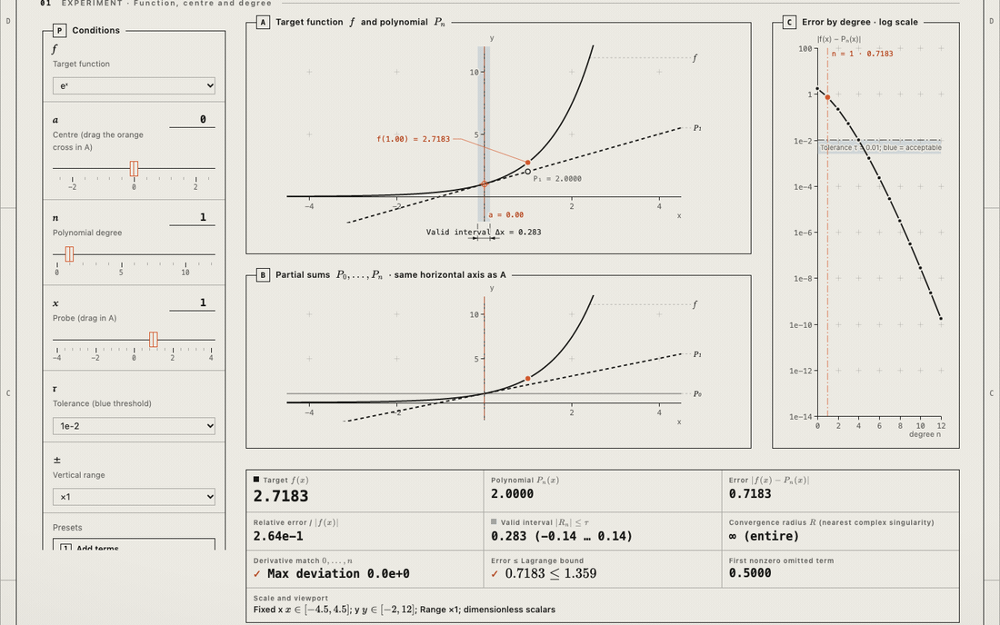
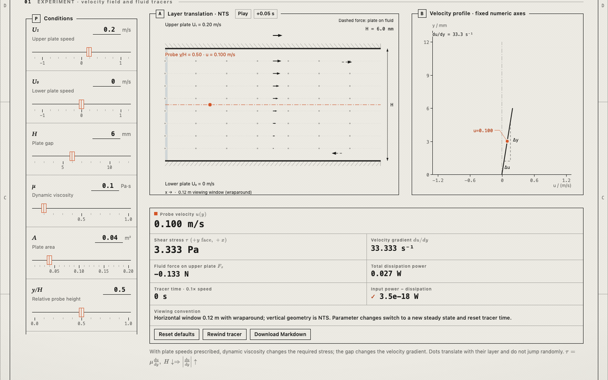

# Specific Learning

[](https://github.com/1762972857-del/specific-learning/actions/workflows/ci.yml)

[English](README.md) | **简体中文**

把一个本科数学或物理概念变成可离线使用的交互式实验，配有原创图示和易读的 Markdown 笔记。可以从一句自然语言问题出发，也可以从上传的课程资料出发。对于自然语言主题，在编写教学模型之前，会先对照权威的大学讲义或公开的技术资料进行核对。

视觉风格采用暖色纸张、墨色线条、橙色选中状态和蓝色区域。桌面端控件位于实验旁边，小屏幕上移到实验上方。公式由本地 KaTeX 渲染。可选的 3D 曲面使用项目自带的小型原生 Canvas 渲染器。

## 两个完整示例

这是两份完整的参考成品：笔记、图示、模型和页面俱全。可以在本地克隆的仓库中直接打开它们的 HTML 文件，也可以用 `python3 -m http.server` 在仓库根目录启动本地服务。

### Taylor expansion

[打开实验](examples/taylor-expansion/viz/taylor-expansion.html) · [阅读指南](examples/taylor-expansion/notes/01-taylor-expansion.md)

拖动多项式阶数，对比局部拟合、部分和与逼近误差。



### Newton's law of viscosity

[打开实验](examples/newton-viscosity/viz/newton-viscosity.html) · [阅读指南](examples/newton-viscosity/notes/01-viscosity.md)

改变移动平板的速度或流体性质，把速度梯度与剪切应力联系起来。



## 模板

`templates/` 中有六个精简的起点模板，提供页面布局、绘图与交互代码、可直接运行的 `model.py`，以及带有 `TOPIC:` 占位符的笔记骨架；它们本身不是教学内容。

| 模板 | 适合作为起点的场景 |
| --- | --- |
| `taylor-expansion` | 逼近与目标函数对比、误差随参数变化、可拖动的展开点 |
| `barrier-tunneling` | 分段的一维区域、波密度、守恒量读数 |
| `partial-derivatives` | 带切片、切线斜率和有限差分的原生 3D 曲面 |
| `newton-viscosity` | 基于固定步长时钟的时间演化、示意图与速度剖面 |
| `double-slit` | 带缓存的二维强度/振幅热图、光程差示意图、屏幕强度分布 |
| `linear-transform` | 等比例网格映射，含可拖动的基向量、行列式与特征方向 |

## 安装

### Skills CLI（推荐）

安装了 Node.js（含 npm/npx）和 Git 后，使用 [Skills CLI](https://github.com/vercel-labs/skills) 为需要的工具安装技能：

| 命令 | 安装位置 |
| --- | --- |
| `npx skills@latest add 1762972857-del/specific-learning -g -a claude-code` | `~/.claude/skills/specific-learning`（指向共享副本的符号链接） |
| `npx skills@latest add 1762972857-del/specific-learning -g -a codex` | `~/.agents/skills/specific-learning` |
| `npx skills@latest add 1762972857-del/specific-learning -g -a opencode` | `~/.agents/skills/specific-learning` |
| `npx skills@latest add 1762972857-del/specific-learning -g -a cursor` | `~/.agents/skills/specific-learning` |
| `npx skills@latest add 1762972857-del/specific-learning -g` | 全局安装；出现选择提示时选择需要的工具 |
| `npx skills@latest add 1762972857-del/specific-learning` | 当前项目的 `.agents/skills/specific-learning`；选中 Claude Code 时还会创建 `.claude/skills/specific-learning` 入口 |

表中路径对应默认的符号链接模式，已用 Skills CLI 1.7.2 验证。此模式下 Codex、OpenCode 和 Cursor 使用共享的 `.agents/skills` 目录。`-g` 表示所有项目可用；不加它时，请在目标项目根目录运行。重复 `-a` 可选择多个工具；需要在工具各自目录保存独立副本时，可加 `--copy`。

Private 仓库沿用已有的 Git、已登录的 GitHub CLI 或 SSH 认证。使用 SSH 时，将仓库参数替换为 `git@github.com:1762972857-del/specific-learning.git`。安装者需要具有仓库访问权限，无须把 token 写进本仓库。

查看和更新全局安装：

```sh
npx skills@latest list --global
npx skills@latest update specific-learning --global
```

从手动安装迁移时，先将开发仓库及本地修改保留在受管理的技能目录之外。CLI 管理的是安装副本，开发仓库应独立保存。

### 手动安装

开发或不使用 CLI 时，可以克隆仓库：

```sh
git clone https://github.com/1762972857-del/specific-learning.git
cd specific-learning
```

将整个目录放入或链接到目标工具的技能目录，例如 Codex 的 `~/.agents/skills/specific-learning` 或 Claude Code 的 `~/.claude/skills/specific-learning`。请让 `SKILL.md`、`references/`、`assets/`、`scripts/`、`templates/` 和 `examples/` 保持在一起，技能通过相对路径读取它们。Skills CLI 也会安装这些资源，本技能不需要另行发布 npm 包。

创作环节需要下表中的环境；只阅读成品实验的读者只需要浏览器。

| 缺少 | 影响 | 解决办法 |
| --- | --- | --- |
| Python (`python3`) | 无法搭建脚手架和构建 | 安装 [uv](https://docs.astral.sh/uv/getting-started/installation/)；用 `uv run --no-project python <script>` 运行脚本 |
| Node.js | 无法通过 Skills CLI 安装；Python/JavaScript 对照检查和 DEFAULTS 检查报告 SKIP | 安装带 npm/npx 的 Node.js，或手动安装技能并接受模型对照检查被跳过 |
| NumPy / matplotlib | 只有用到它们的图示会失败 | `viz/build.py` 会通过 uv 重试 |
| 浏览器自动化 (Playwright) | `viz/qa.py` 无法运行；需手动检查 | 可选；`qa.py` 会通过 uv 重试，也可使用宿主的浏览器工具 |

## 如何使用

安装后，在项目中打开你的编程助手，直接用自然语言提出需求：

```text
给我讲解泰勒展开。
可视化线性变换。
把上传的课件整理成交互实验页和讲义。
```

可以补充学习程度、输出语言或关注点，例如“展示矩阵各列如何按输入向量的分量加权”。如果助手没有自动选择技能，可以明确说“使用 specific-learning 技能……”。它会生成 HTML 实验页和 Markdown 讲义；用浏览器打开生成的 HTML 即可操作。

### 手动搭建脚手架

入口是 [SKILL.md](SKILL.md)。脚手架会把真实文件复制到输出目录，因此每个生成的主题都可以独立移植。

在技能目录下运行：

```sh
python3 scripts/new_topic.py /tmp/my-taylor my-taylor \
  --template taylor-expansion --source prompt
```

`--template` 可选的值就是 `templates/` 下的各个目录（见上方模板表）。上传了课程资料时使用 `--source courseware`，这会额外创建 `sources/` 目录。可选的 `--lang <BCP47>`（默认 `en`，例如 `zh-CN`）用于设置 `<html lang>`；笔记请使用同一种语言撰写。可选的 `--main` 和 `--sub` 只改变页面上显示的标题，不改变课程本身的模型。请把模型、图示、页面和笔记一起改写。重复运行该命令时，已有文件会被保留。

## 查看与创作

**读者只需要浏览器。** 成品实验自带本地的 KaTeX、marked、字体，以及打包好的笔记和图示，无需网络连接，也无需安装 Python。

**创作工具**见“安装”一节。构建脚本、检查器、脚手架和 Markdown 打包器只使用 Python 标准库；`qa.py` 另外需要 Playwright。

在生成主题的根目录下运行：

```sh
python3 viz/build.py              # figures (if any), notes bundle, checks
python3 viz/build.py --no-figures # skip figures.py; --no-node skips the Python/JS comparison
python3 viz/qa.py                 # browser acceptance (or build.py --qa)
python3 -m http.server            # open the page in a browser
```

`build.py` 在第一个失败的步骤处停止，并以 `check.py` 的状态码退出。如果 `figures.py` 或 `check.py` 需要当前 Python 没有的包（例如 NumPy），它会通过 `uv run --no-project` 重试该步骤（若主题中有 `requirements.txt` 则一并使用）；没有 `uv` 时，它会打印出确切的命令。它绝不会向系统 Python 中安装任何东西。

每个模板都会说明自己额外的检查项。这些检查用于验证参考用例、边界条件以及各实现之间的一致性；它们不能证明所有输入都成立，也不能代替数学推理。关于假设、单位、数值限制和直接的来源链接，请查阅指南。

## 仓库结构

| 位置 | 职责 |
| --- | --- |
| `SKILL.md`, `references/` | 工作流程、资料来源规则，以及渲染和模型约定 |
| `assets/` | 共享样式、绘图辅助代码、可选的 3D 渲染器和本地第三方库 |
| `examples/` | 两份完整的参考成品（`taylor-expansion`、`newton-viscosity`）：模型、图示、指南和页面 |
| `templates/` | 六个精简的布局与绘图起点（页面、模型、笔记骨架） |
| `scripts/new_topic.py` | 从模板搭建独立的主题脚手架 |
| `scripts/build.py` | 一键构建：图示、打包、检查；缺少依赖包时回退到 `uv` |
| `scripts/qa.py` | 基于 Playwright 的浏览器验收：HTTP 检查 1440px 与 390px，`file://` 检查 1440px，以及阅读器和截图；主题自己的步骤写在 `viz/qa.json` 中 |
| `scripts/check.py` | 已知结果、跨语言和结构检查 |
| `scripts/bundle_notes.py` | 打包 Markdown 和图示，供离线阅读 |
| `scripts/selftest.sh` | 仓库自测：为每个模板搭建脚手架，检查示例、曲面渲染器和打包文件是否最新 |
| `docs/demos/` | 真实浏览器交互的 GIF 录屏 |

## 开发

仓库各目录的角色、如何添加模板以及自测，请参阅 [CONTRIBUTING.md](CONTRIBUTING.md)（英文）。私有交付物、本地交接笔记、缓存和环境目录已被 `.gitignore` 排除。

示例中引用大学资源仅用于核对验证；这些资源的原始文档不随本项目分发。

## 许可证

MIT；见 [LICENSE](LICENSE)。`assets/vendor/` 下内置的 KaTeX 和 marked 库保留各自的 MIT 许可证。
