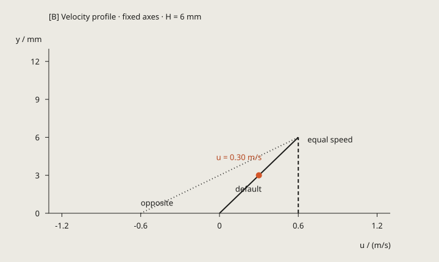

# Newton's law of viscosity: read velocity difference as shear

Sources: the learning goal of the original experiment; [Arnedo, §3.1.4 Viscosity](https://eng.libretexts.org/Bookshelves/Aerospace_Engineering/Fundamentals_of_Aerospace_Engineering_(Arnedo)/03%3A_Aerodynamics/3.01%3A_Fundamentals_of_fluid_mechanics/3.1.04%3A_Viscosity) and [Liburdy, Intermediate Fluid Mechanics, VII. Introduction to Viscous Flows](https://open.oregonstate.education/intermediate-fluid-mechanics/chapter/introduction-to-viscous-flows/). Pages checked 2026-10-10. Text, figures, and the experiment are independently reconstructed.

Prerequisites: linear functions, derivatives, force, and power. Interactive experiment: [open the experiment](../viz/newton-viscosity.html).
Labels: [Standard result] a textbook relation; [Derivation] follows from stated conditions; [Model assumption] a simplification used here.

## 1. Object, definition, and conditions

Two sufficiently large parallel plates contain an incompressible Newtonian fluid. The lower plate is at $y=0$ with speed $U_0$; the upper plate is at $y=H$ with speed $U_1$. The $x$ direction is to the right and $y$ points from the lower plate to the upper plate. The velocity field is $\mathbf v=(u(y),0)$, so there is no vertical velocity. We assume steady laminar flow, constant viscosity $\mu$, no streamwise pressure gradient, no slip, and no wall-normal flow. [Model assumption]

Here $\tau$ means the viscous shear stress on a face whose normal points in $+y$, directed along $+x$; a negative sign means the opposite direction. Newton's law of viscosity for simple shear is:

$$
\tau=\mu\frac{du}{dy}.
$$

This is a constitutive relation (a material response law): it says that stress is proportional to shear rate. Geometry alone cannot prove it. [Standard result, Arnedo §3.1.4]

## 2. Formula, figure, numbers, and intuition

| Representation | This page shows | Location |
|---|---|---|
| Symbol | $u(y)=U_0+(U_1-U_0)y/H$ | Derivation panel |
| Situation | Each layer translates at its own speed | A, layered tracers |
| Number | Default midpoint $u=0.30$ m/s | A readout and B probe |
| Language | Stress depends on velocity gradient | Presets and explanation |

<!-- sl:reading -->

**Reading the figure**

- The solid line is the default $U_0=0,U_1=0.6$ m/s; the dashed line is equal plate speed; the dotted line is equal and opposite speed. The vermilion point marks the default probe.
- The default values in `figures.json` are $y=0.003$ m, $u=0.30$ m/s, gradient $100$ s$^{-1}$, stress $10$ Pa, and dissipation $0.24$ W; $H=6$ mm, $\mu=0.1$ Pa·s, and $A=0.04$ m$^2$.
- Equal plate speeds give zero velocity difference and zero stress. With opposite speeds, the midpoint can be stationary while stress remains nonzero. [Derivation]
- The horizontal axis is $u$ and the vertical axis is $y$. The gradient is a horizontal velocity difference divided by a vertical height difference, with mm converted to m; it is not the line's visual pixel slope. The axes represent different physical quantities and are not an equal-scale geometric view.

Tracer dots in A follow $\Delta x=u(y)\Delta t$ at fixed $y$; there is no random jitter or molecular collision model. The horizontal window is 0.12 m: a dot leaving the right edge reappears on the left, and negative velocity moves it backward. This is a viewing wraparound, not a closed fluid loop. The vertical geometry is NTS (not to scale). Solid velocity arrows share one length scale; dashed force arrows show direction only. The fog-blue band marks the fluid height. The right-angle dashed construction in B is a difference quotient, not a flow path. [Representation convention]

## 3. Derivation and verification basis

Adjacent layers separated by $\Delta y$ develop relative displacement $\Delta x=\Delta u\Delta t$ during $\Delta t$; the small shear-angle rate approaches $du/dy$, so the gradient represents shear deformation rate. [Derivation]

For steady parallel flow without a pressure gradient, $d\tau/dy=0$. Constant $\mu$ gives $d^2u/dy^2=0$, so $u=C_1y+C_2$. Applying no-slip boundaries $u(0)=U_0$ and $u(H)=U_1$ gives:

$$
u(y)=U_0+\frac{U_1-U_0}{H}y,\qquad\tau=\mu\frac{U_1-U_0}{H}.
$$

This is an analytic steady state; changing a parameter switches directly to a new steady state and does not simulate startup. [Derivation; conditions follow Liburdy VII]

The upper plate exerts $+\tau A$ on the fluid and the lower plate exerts $-\tau A$; the fluid forces on the plates point oppositely. Reversing the velocity difference reverses the force direction. The net input power is:

$$
P_{\rm in}=\tau A U_1-\tau A U_0=\mu A\frac{(U_1-U_0)^2}{H}.
$$

Integrating the dissipation density $\mu(du/dy)^2$ over volume $AH$ gives the same $P_{\rm diss}\geq0$. This is an energy balance in which mechanical energy becomes internal energy; it is not mechanical-energy conservation. The small check cell compares the two independently evaluated expressions. [Derivation]

`model.py` and the HTML model are independent implementations. `check.py` tests 12 hand-calculated cases: default, both walls, equal speed, opposite speed, negative shear, half gap, tenfold viscosity, advection and no penetration, the most negative gradient at the control limits, low viscosity, and larger area. It then compares every named output from Python and JavaScript. Absolute and relative tolerances are $10^{-10}$. The finite cases do not prove every input or real-flow stability. There is no random, numerical-solver, or convergence module, so this page does not add confidence intervals or observed order. [Verification scope]

The animation uses `Draft.clock` with a fixed physical step of 0.001 s, playback at 0.1× physical speed, and a 0.05 s single step. Position is computed analytically from velocity, with no accumulated integration error. Parameter changes pause and reset time; moving the probe preserves time; background time is not backfilled. The default is paused, and reduced-motion mode does not autoplay. [Implementation convention]

## 4. Units and scope

<!-- sl:scope -->

| Quantity | Meaning | Unit |
|---|---|---|
| $U_0,U_1,u$ | Streamwise velocity | m/s |
| $H,y$ | Gap and height | m; controls display mm |
| $\mu$ | Dynamic viscosity | Pa·s |
| $du/dy$ | Velocity gradient | s$^{-1}$ |
| $\tau$ | Shear-stress component | Pa |
| $A,F_x,P$ | Area, force, power | m$^2$, N, W |

$[\mu du/dy]=[\mathrm{Pa\cdot s}][\mathrm{s}^{-1}]=[\mathrm{Pa}]$, and stress times area is force. [Derivation]

The model does not specify a real liquid, density, or temperature; infer no turbulence; and does not simulate non-Newtonian fluids, inlet effects, pressure-driven flow, startup, free surfaces, or edge effects. Area $A$ is used only for force and power. The laminar solution does not guarantee that every real apparatus is stable. [Model limitation]

## 5. Pitfalls

<!-- sl:pitfalls -->

- Fast flow does not imply large shear stress: equal plate speeds produce rigid translation and zero gradient.
- Increasing viscosity does not necessarily slow the flow: this page prescribes plate speeds, so viscosity changes the sustaining force. Prescribed-force flow is a different problem.
- Zero speed does not imply zero stress: with opposite plate speeds, the midpoint is stationary while neighboring layers still differ in speed.
- A viscous force does not always point left: specify the object and face; action and reaction point in opposite directions. [Derivation]

## 6. Predict first, then check

<!-- sl:predict -->

Reset each time, then try equal speed, viscosity × 10, and half the gap, comparing profile, stress, and dissipation.

Explanation

Equal speed: gradient, stress, and dissipation are zero. Viscosity × 10: velocity remains 0.30 m/s, stress becomes 100 Pa, and dissipation becomes 2.4 W. Half the gap: stress becomes 20 Pa and dissipation 0.48 W; because relative probe height stays fixed, velocity remains 0.30 m/s. Change one factor at a time. [Derivation]

## 7. Suggested hands-on sequence

1. Start paused and read the plate speeds, layer arrows, and velocity profile.
2. Single-step and play the tracer to compare displacement in different layers.
3. Drag the A probe or enter $y/H$ and check that A, B, and the title readouts stay linked.
4. Reset each time, then try equal speed, viscosity × 10, and half the gap.
5. Select opposite speeds, change the sign of the upper speed, and check shear stress and fluid force on the upper plate.
6. Open the guide to review the formula and static figure; press Esc to close it.
