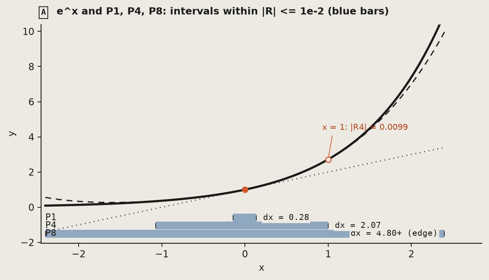
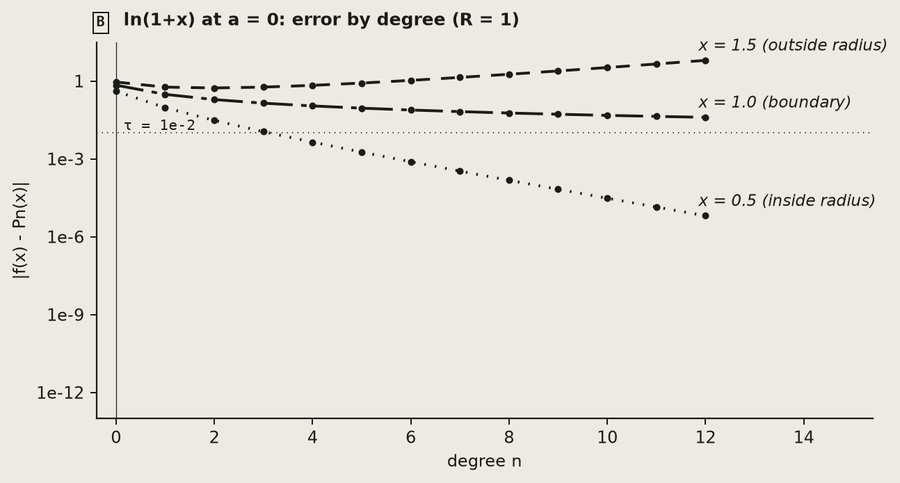
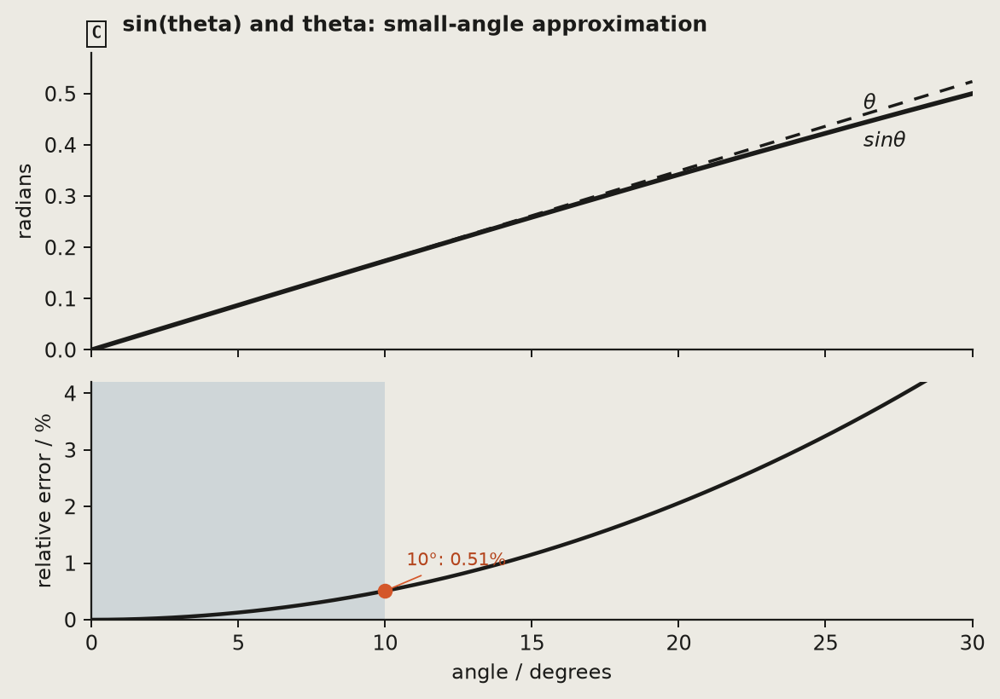

# Taylor expansion: replacing a function locally

This original lesson uses real functions of one dimension. Prerequisites: derivatives, Rolle's theorem and basic series convergence. Open `viz/taylor-expansion.html`. Defaults: $f=e^x$, centre $a=0$, degree $n=4$, probe $x=1$, tolerance $\tau=10^{-2}$.

Sources checked: [MIT 18.100A, Lecture 20: Taylor's theorem](https://ocw.mit.edu/courses/18-100a-real-analysis-fall-2020/mit18_100af20_lec20.pdf), [MIT 18.01SC, Session 99](https://ocw.mit.edu/courses/18-01sc-single-variable-calculus-fall-2010/pages/unit-5-exploring-the-infinite/part-b-taylor-series/session-99-taylors-series-continued/), and [MIT Calculus with Applications, §30.4: radius of convergence](https://ocw.mit.edu/ans7870/18/18.013a/textbook/HTML/chapter30/section04.html). Prose, models and figures here are original; no course images or exercises are bundled.

## 1. Definition and conditions

For a real function $f$, its degree-$n$ Taylor polynomial about $a$ is

$$P_n(x)=\sum_{k=0}^{n}\frac{f^{(k)}(a)}{k!}(x-a)^k.$$

It is the unique polynomial of degree at most $n$ satisfying

$$P_n^{(k)}(a)=f^{(k)}(a),\qquad k=0,\ldots,n.$$

[Derivation] Write the polynomial as $\sum c_k(x-a)^k$. Its $k$th derivative at $a$ is $k!c_k$, so matching derivatives determines each coefficient uniquely.

The Lagrange remainder has the form

$$R_n(x)=f(x)-P_n(x)=\frac{f^{(n+1)}(\xi)}{(n+1)!}(x-a)^{n+1}.$$

[Standard result] Continuous derivatives through order $n+1$ on an interval containing $a,x$ are sufficient. The point $\xi$ lies between them. If $\lvert f^{(n+1)}(t)\rvert\le M$ throughout the interval, then

$$\lvert R_n(x)\rvert\le\frac{M\lvert x-a\rvert^{n+1}}{(n+1)!}.$$

See MIT 18.100A Lecture 20. Numerical agreement is not a proof of the theorem.

| Symbol | Meaning | Type |
| --- | --- | --- |
| $f$ | Target function | $D\to\mathbb R$, $D\subseteq\mathbb R$ |
| $a$ | Centre inside the domain | Real scalar |
| $n$ | Degree, $0,\ldots,12$ on this page | Nonnegative integer |
| $c_k$ | Coefficient $f^{(k)}(a)/k!$ | Real scalar |
| $R_n$ | Finite-polynomial remainder | Function on the domain |
| $R$ | Infinite-series convergence radius | Positive real number or $\infty$ |

## 2. Symbols, graphs, numbers and intuition

| Representation | Meaning | Location |
| --- | --- | --- |
| Formula | $P_n(x)=\sum c_k(x-a)^k$ | Current polynomial, updated with $a,n$ |
| Graph | Solid $f$, dashed $P_n$, thin $P_0,\ldots,P_{n-1}$ | A and B share a horizontal axis |
| Numbers | Target, approximation, error, valid width and omitted term | Readout board |
| Explanation | More matched derivatives improve local approximation; convergence depends on $\lvert x-a\rvert<R$ | A's radius annotation and C's error curve |

<!-- sl:reading -->

**Reading the figure**

- Look for: solid $e^x$ and degree-one, degree-four and degree-eight approximations distinguished by line style. Blue bars show intervals containing $a=0$ where $\lvert R_n\rvert\le10^{-2}$; orange marks the centre and probe.
- Read: widths are $0.283$, $2.07$ and at least $4.80$. The last bar reaches the plot edge. At $x=1$, $\lvert R_4\rvert=9.948\times10^{-3}$ (`figures/figures.json`).
- Conclude: raising degree increases the interval meeting this tolerance in this example. [Derivation]
- Pitfall: a clipped width is a lower bound, not an exact value. Changing tolerance changes the intervals; this figure only covers $[-2.4,2.4]$.

<!-- sl:reading -->

**Reading the figure**

- Look for: errors for $\ln(1+x)$ at $a=0$ with probes $x=0.5,1,1.5$. The vertical axis is logarithmic.
- Read: at degree twelve the errors are $6.42\times10^{-6}$, $3.99\times10^{-2}$ and $6.27$.
- Conclude: the interior probe converges quickly; outside radius one the series diverges. The boundary probe $x=1$ still converges, with error asymptotic to $1/(2(n+1))$. [Derivation] [Standard result]
- Pitfall: each boundary point needs a separate test. A finite plot alone cannot prove convergence.

<!-- sl:reading -->

**Reading the figure**

- Look for: $\sin\theta$ versus $\theta$, and relative error $\lvert\theta-\sin\theta\rvert/\lvert\sin\theta\rvert$.
- Read: at $10^\circ$, $20^\circ$, $30^\circ$ the errors are about $0.5095\%$, $2.06\%$, $4.72\%$.
- Conclude: “small angle” depends on the allowed error. [Derivation]
- Pitfall: Taylor formulas use radians. The model converts the displayed degrees first. Relative error is undefined when the exact value is zero.

## 3. Derivation and verification

For $x\ne a$, choose $C$ so that $F(x)=0$, where

$$\begin{aligned}F(t)&=f(t)-P_n(t)\\&\quad-C(t-a)^{n+1}.\end{aligned}$$

Because $F^{(k)}(a)=0$ for $k=0,\ldots,n$, repeated Rolle arguments give $F^{(n+1)}(\xi)=0$. Thus $C=f^{(n+1)}(\xi)/(n+1)!$, giving the remainder. At $x=a$ it is directly zero. [Derivation]

| Case | Actual error | Lagrange bound | First nonzero omitted term |
| --- | --- | --- | --- |
| $\ln(1+x)$, $a=0,n=2,x=0.5$ | $3.0465\times10^{-2}$ | $1/24$ | $4.1667\times10^{-2}$ |
| $1/(1+x)$, $a=0,n=3,x=-0.5$ | $0.125$ | $2$ | $0.0625$ |
| $e^x$, $a=0,n=4,x=1$ | $9.9485\times10^{-3}$ | $e/120$ | $8.3333\times10^{-3}$ |

[Derivation] A bound and an omitted term are different objects. A derivative maximum at an endpoint does not mean the unknown remainder point $\xi$ equals that endpoint.

The page checks analytic derivatives against $k!c_k$ and actual error against an applicable derivative bound. `check.py` verifies 15 independent cases with fixed high-precision decimal or exact rational references, then compares the separate Python and JavaScript implementations. `extra_checks` in `model.py` adds 13-point finite differences through derivative order four and a seeded random bound sweep. Its step is $0.01$ and tolerance $10^{-6}$; higher derivatives amplify rounding noise. These checks cover selected cases, not every input.

## 4. Units and scope

<!-- sl:scope -->

Inputs are dimensionless real scalars; polynomial values and remainders have the same type as the function value. For functions singular at $-1$, centres are restricted to $[-0.8,2.5]$. An invalid probe produces a domain message, not zero error. A bound across a singularity is inapplicable.

[Standard result] For the analytic functions here, the Taylor radius is the distance to the nearest complex singularity (MIT §30.4). At zero, $1/(1+x^2)$ has radius one because of poles at $\pm i$, although it is real analytic everywhere on the real axis. This is not a smooth nonanalytic example.

The horizontal range is fixed at $[-4.5,4.5]$. The 1201 samples break outside the domain or vertical range. The valid interval is the sampled connected component containing the centre, with linearly interpolated tolerance crossings. Sampling and floating-point cancellation limit this estimate. Error values below $10^{-14}$ are floored in C and labelled; this does not prove exact equality.

## 5. Pitfalls

<!-- sl:pitfalls -->

- Extra terms need not improve error at every step, even inside a convergent series.
- A finite polynomial can be evaluated outside the series radius; increasing its degree there need not improve it.
- Parity may make several omitted coefficients zero. The first nonzero term is not automatically an upper bound.
- A and C use the same model. Their agreement checks display consistency, not the model independently.

## 6. Predict, then test

<!-- sl:predict -->

Keep $f=e^x,a=0,x=1$. Predict the error as you drag degree from one to eight. Will the bound remain valid? Then move the probe to $x=3$. Finally compare logarithm probes inside and outside its radius.

Explanation

Default errors at degrees one, four and eight are about $0.718$, $9.95\times10^{-3}$ and $3.06\times10^{-6}$. Here successive errors have ratio asymptotic to $1/(n+2)$. The bound uses $M=e^{\max(a,x)}$. At $x=3$, degree eight has error $7.64\times10^{-2}$ and degree twelve $3.24\times10^{-4}$. The exponential series converges at every real probe, but distant probes need more terms. Outside the logarithm's radius, the error eventually grows. [Derivation]

## 7. Suggested interaction sequence

1. Compare default error with the first omitted term.
2. Drag degree while watching A's interval and B's partial sums.
3. Change tolerance to $10^{-4}$.
4. Choose “At the radius”; compare probes $0.5,1,1.5$ in C.
5. Try “Smooth, finite radius” and “Move the centre”.
6. Open the Guide to repeat the figure readings; Escape returns to the experiment.
